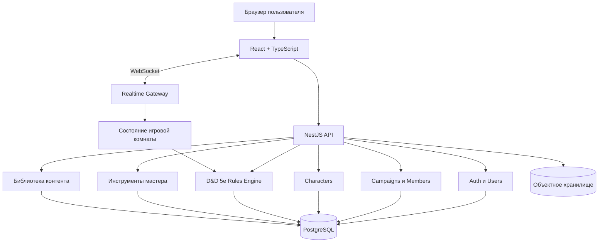

# DnD_Dcorp — архитектура приложения

**Версия:** 0.1  
**Статус:** архитектурная основа утверждена  
**Платформа:** веб-приложение  
**Игровая система:** D&D 5e  
**Рабочая ветка:** `docs/initial-planning`

## 1. Архитектурные принципы

1. Игровые правила DnD_Dcorp соответствуют D&D 5e. Ранее согласованные собственные механики заменены стандартными правилами D&D 5e.
2. Правила отделены от пользовательского интерфейса и реализуются в отдельном серверном модуле.
3. Сервер является доверенным источником состояния игры: клиент не определяет окончательные результаты проверок, бросков и игровых действий.
4. Данные аккаунта, личного персонажа, кампании и сессионного состояния персонажа разделены.
5. Скрытая информация мастера не отправляется клиентам, не имеющим права её видеть.
6. На начальном этапе используется модульный монолит, а не распределённая система микросервисов.
7. Архитектура должна позволять поэтапно добавлять функции без переписывания уже работающих модулей.

## 2. Предлагаемый технологический стек

| Область | Технология | Назначение |
|---|---|---|
| Frontend | React + TypeScript | Клиентское веб-приложение |
| Стилизация | Tailwind CSS | Компоненты и адаптивная раскладка |
| Backend | Node.js + NestJS | API, бизнес-логика и серверные модули |
| База данных | PostgreSQL | Постоянное хранение структурированных данных |
| ORM | Prisma | Модели, миграции и доступ к БД |
| Реальное время | WebSocket / Socket.IO | События игровой комнаты и синхронизация |
| Тесты | Vitest + Playwright | Модульные, интеграционные и пользовательские проверки |
| Файлы | S3-совместимое объектное хранилище | Карты, изображения и вложения |

Выбор является утверждённой архитектурной основой. Конкретные версии пакетов, провайдеры размещения и конфигурация инфраструктуры определяются перед реализацией.

## 3. Схема компонентов



## 4. Серверные модули

### 4.1 Auth и Users
- Регистрация, вход, выход и управление пользовательской сессией.
- Хранение профиля пользователя.
- Проверка подлинности запросов.
- Восстановление доступа и безопасное управление учётными данными.

Гостевой вход не предусматривается.

### 4.2 Campaigns
- Создание и настройка кампаний и игровых сессий.
- Название, описание, состояние и настройки доступа.
- Пригласительные ссылки и каталог доступных сессий.
- Сохранение состояния кампании и игрового журнала.

### 4.3 Members и Permissions
- Заявки на вступление и решение мастера.
- Список участников, исключение, временная блокировка и разблокировка.
- Закрытие приёма новых заявок.
- Роли: мастер, помощник мастера, игрок, наблюдатель.
- Дополнительные разрешения, назначаемые мастером.

Проверка прав выполняется на сервере для каждого защищённого действия. Скрытие кнопки в интерфейсе не считается контролем доступа.

### 4.4 Characters
- Личные карточки персонажей пользователя.
- Отдельные копии/сессионные состояния персонажа для каждой кампании или сессии.
- Характеристики, навыки, классовые и расовые особенности, здоровье, ресурсы, инвентарь, способности и прочие поля листа.
- История изменений и проверка разрешений на редактирование.

Изменения сессионного состояния не должны автоматически перезаписывать личную карточку или состояние того же персонажа в другой сессии.

### 4.5 D&D 5e Rules Engine
- Централизованная реализация расчётов и игровых процедур D&D 5e.
- Проверки характеристик и навыков, спасброски, атаки, урон, состояния, отдых, лечение, заклинания и другие правила.
- Проверка допустимости игровых действий и применение их последствий.
- Единые серверные функции расчёта, используемые API и игровым столом.

Правила сверяются с предоставленными проекту руководствами D&D 5e. Не следует создавать альтернативную систему характеристик или заменять официальные процедуры произвольными формулами. Неоднозначные случаи и опциональные правила должны быть документированы с указанием выбранного варианта.

### 4.6 Virtual Tabletop
- Карты, сцены, сетка, токены и измерения.
- Позиции игровых объектов и их состояние.
- Слои и управление видимостью.
- Раздельные представления мастера и игроков.

### 4.7 Realtime
- Передача событий игровой комнаты подключённым участникам.
- Синхронизация перемещений, бросков, сообщений и изменений состояния.
- Проверка прав перед отправкой событий и данных каждому получателю.
- Повторное получение актуального состояния после переподключения.

### 4.8 Game Master Tools
- NPC, противники, сцены и встречи.
- Скрытые заметки и закрытая информация.
- Управление событиями и игровыми ситуациями.

### 4.9 Content Library
- Каталог игрового контента и шаблонов.
- Поиск, фильтрация и привязка контента к кампании.
- Разграничение системного и пользовательского контента.

### 4.10 Dice и Logs
- Броски кубиков, поддерживаемые формулы и журнал результатов.
- Серверная генерация результатов.
- Сохранение значимых игровых событий для аудита и истории кампании.

## 5. Основные сущности данных

Предварительная модель данных:

- **User** — учётная запись пользователя.
- **UserProfile** — публичные и пользовательские настройки профиля.
- **Campaign** — кампания.
- **GameSession** — игровая сессия/комната в рамках кампании.
- **SessionInvitation** — приглашение и параметры его действия.
- **JoinRequest** — заявка на вступление.
- **CampaignMember** — участник кампании, его роль и статус.
- **Permission** — дополнительные разрешения.
- **Character** — личная карточка персонажа.
- **SessionCharacter** — отдельное состояние персонажа в конкретной сессии.
- **CharacterEvent** — история изменений персонажа.
- **Scene** — игровая сцена.
- **MapAsset** — файл карты или изображения.
- **GameObject** — токен или объект игровой сцены.
- **RuleSetVersion** — версия используемого набора правил/контента.
- **GameEvent** — событие игрового процесса.
- **DiceRoll** — результат броска и его контекст.
- **ChatMessage** — сообщение чата.

Связи и ограничения целостности будут уточнены в ER-диаграмме перед созданием миграций БД.

## 6. Потоки взаимодействия

### 6.1 Подключение игрока
1. Пользователь регистрируется и входит в аккаунт.
2. Находит открытую сессию в каталоге либо переходит по приглашению.
3. При необходимости вводит пароль сессии.
4. Отправляет заявку на вступление.
5. Мастер одобряет или отклоняет заявку.
6. После одобрения сервер проверяет права и разрешает доступ.
7. Игрок выбирает личного персонажа.
8. Сервер создаёт независимое состояние персонажа для этой сессии.

### 6.2 Игровое действие
1. Клиент отправляет намерение выполнить действие.
2. Сервер проверяет личность пользователя, членство, роль и разрешения.
3. Rules Engine проверяет применимость действия по D&D 5e.
4. Сервер рассчитывает результат и сохраняет изменения.
5. Realtime Gateway рассылает каждому участнику только разрешённую ему часть обновления.

## 7. Безопасность

- Пароли аккаунтов хранятся только в виде стойких хешей с солью.
- Пароли сессий также не хранятся в открытом виде.
- Пригласительные токены должны быть криптографически случайными, ограниченными по назначению и отзывными.
- Сервер проверяет права на каждую операцию чтения и изменения.
- Данные мастера и скрытые объекты фильтруются на сервере до отправки клиенту.
- Вводимые пользователями данные валидируются.
- Загрузка файлов ограничивается допустимыми форматами, размером и правами доступа.
- Важные действия и изменения состояния журналируются.
- Секреты и ключи не хранятся в репозитории и клиентском коде.
- Для развёрнутого приложения используется HTTPS.

## 8. Предлагаемая структура репозитория

```text
DnD_Dcorp/
├── apps/
│   ├── web/                  # React-клиент
│   └── api/                  # NestJS-сервер
├── packages/
│   ├── shared/               # Общие типы и схемы DTO
│   └── rules-5e/              # Доменные типы и логика D&D 5e
├── prisma/
│   ├── schema.prisma
│   └── migrations/
├── docs/
│   ├── ARCHITECTURE.md
│   ├── TECHNICAL_SPEC.md
│   ├── ROADMAP.md
│   └── PLAYER_GUIDE.md
├── tests/
├── .github/
│   └── workflows/
├── package.json
└── README.md
```

Это целевая структура. Каталоги и файлы будут создаваться по мере реализации соответствующих модулей, а не заранее пустыми.

## 9. Тестирование

- Модульные тесты доменных правил и расчётов D&D 5e.
- Тесты прав доступа для каждой роли.
- Интеграционные тесты API и транзакций БД.
- Проверки изоляции личной карточки и сессионных копий персонажа.
- Проверки фильтрации скрытых данных.
- Тесты синхронизации, переподключения и одновременных действий.
- Сквозные сценарии регистрации, создания кампании, вступления и игровой сессии.

## 10. Этапы реализации после архитектуры

1. Уточнить ER-модель и структуру API.
2. Спроектировать навигацию и основные экраны.
3. Создать каркас монорепозитория и CI.
4. Реализовать авторизацию и пользователей.
5. Реализовать кампании, заявки, роли и права.
6. Реализовать персонажей и сессионные копии.
7. Реализовать и проверить ядро D&D 5e.
8. Реализовать игровой стол и синхронизацию.
9. Добавить инструменты мастера и библиотеку контента.
10. Провести интеграционное тестирование и подготовить публикацию.

## 11. Статус решений

Утверждено:
- Веб-приложение для мастера и игроков.
- Архитектурная основа: React, TypeScript, NestJS, Node.js, PostgreSQL, Prisma, WebSocket.
- Модульный монолит с отдельным серверным ядром D&D 5e.
- Обязательная регистрация и авторизация.
- Подключение к сессии через каталог и приглашение; пароль сессии может быть включён.
- Ручное одобрение новых участников мастером.
- Управление заявками, исключением, блокировкой, ролями и дополнительными разрешениями.
- Четыре роли: мастер, помощник мастера, игрок, наблюдатель.
- Все игровые механики берутся из D&D 5e; прежние пользовательские отклонения отменены.

Предстоит детализировать в следующих проектных документах: ER-диаграмму, контракты API, матрицу разрешений, модель событий WebSocket, макеты экранов, конкретные версии зависимостей и инфраструктуру размещения.
